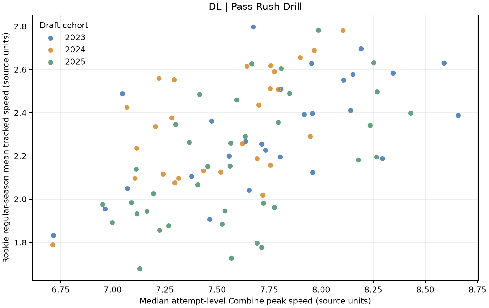
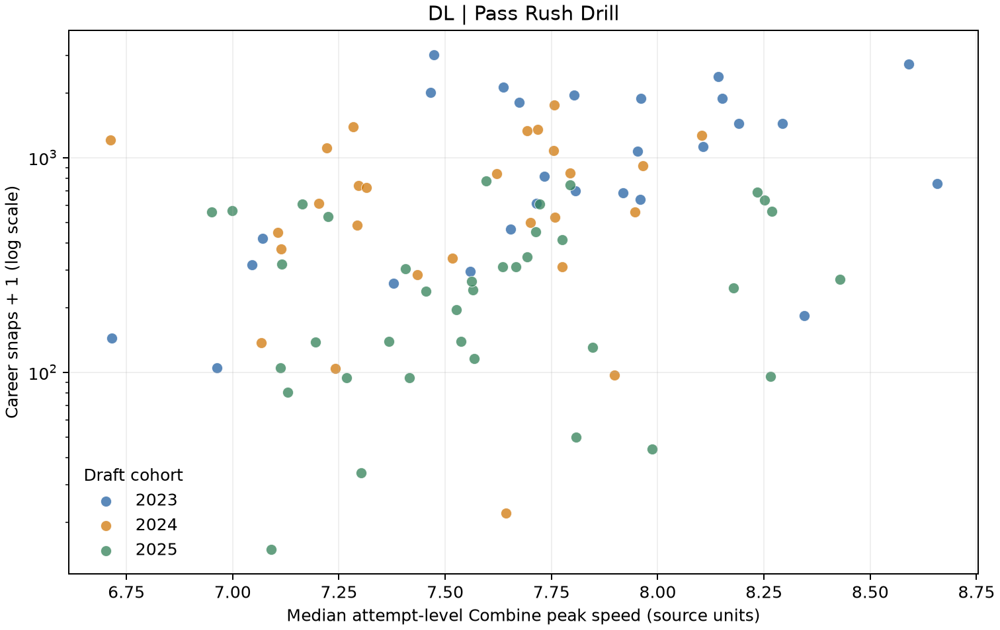
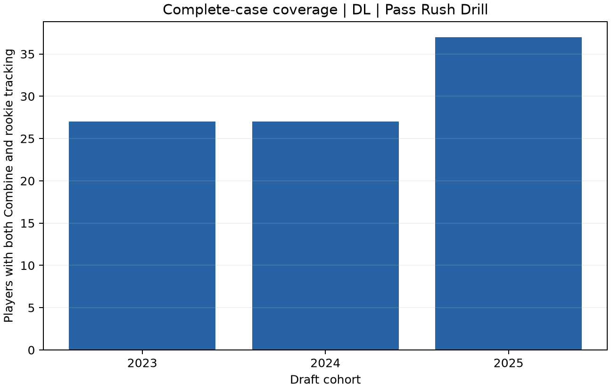

# GridironIQ: Combine Movement and Rookie NFL Tracking

**Research question:** Among DL prospects in the SKILL_DRILLS_DL category, is median attempt-level player peak speed in the PASS_RUSH_DRILL Combine drill associated with rookie-season mean tracked speed after accounting for draft cohort, and does the association remain after additionally controlling for the 40-yard time?

## Competition fit

The official 2027 event asks for an analytical framework linking 10 Hz Combine sensor tracking to future regular-season performance. It is a human-evaluated write-up challenge, not a prediction leaderboard: the official evaluation requires an explicit Combine-to-NFL linkage and a complete write-up with readable markdown, embedded visuals, and an attached public Kaggle Notebook. Its four scored components are Football (30%), Data Science (30%), Write-up (20%), and Data Visualization (20%). The competition has no sample prediction-submission file among the nine official data files; no prediction CSV was fabricated or uploaded.

## Data and linkage

The audit verified 9 official CSV files, their exact byte sizes, SHA-256 digests, headers, row counts, missingness, numeric ranges, composite-key duplicates, and player-ID join coverage. See [data inventory](audit/data_inventory.md), [column-level quality audit](tables/data_quality.csv), [player-ID joins](tables/join_coverage.csv), [game-ID joins](tables/game_id_join_coverage.csv), [value checks](tables/value_checks.csv).

Tracking CSVs were scanned in chunks. Combine tracking includes both `PLAYER` and `BALL` entities at the same event/time; composite-key checks include `entity_type`, and only `PLAYER` rows contribute to athlete features. Rookie outcomes use `games.csv` to select only games marked `REG` and the player's draft-year season; this avoids using later tracking observations as rookie outcomes. Combine trajectories are ordered by their observed timestamps and summarized at the player/drill level. Game speed and acceleration are means over observed tracking frames; they are exposure- and role-dependent, not isolated skill measures. Coordinates outside the nominal playing-surface rectangle are reported as range checks, not automatically treated as bad data: trackers can record players beyond the sidelines/end lines, and Combine sensor coordinates use a separate setup. Signed acceleration, including negative values, is retained. No distance comparison across coordinate systems is made; path efficiency is dimensionless. Career snaps are supplied aggregates and have unequal follow-up, so they are a secondary outcome, never a predictor.

## Cohort selection and results

To avoid selecting a drill based on its outcome correlation, the primary position, drill category, and drill are the exact skill-drill group with the most complete unique players (Combine movement, career outcomes, and at least 100 rookie regular-season tracking frames). The cohort is selected by coverage only; records with the same drill name but a different drill category are not combined. See [candidate coverage](tables/drill_candidate_coverage.csv). Player-level intermediate tables are generated locally but are not included in this public release.

The cohort-adjusted rank correlation was 0.579 (player-bootstrap 95% interval 0.423 to 0.706; n=91). The corresponding partial correlation controlling for cohort and 40-yard time was 0.088 (player-bootstrap 95% interval -0.142 to 0.336; n=71). The partial interval includes zero, so the observed association does not clearly add information beyond the timed 40-yard result in this sample. These are exploratory associations, not causal or out-of-sample predictive effects.

### Exploratory associations

| Feature | Outcome | n | Cohort-adjusted rank correlation | Player-bootstrap 95% interval |
|---|---|---:|---:|---|
| Combine peak speed | Rookie mean speed | 91 | 0.579 | 0.423 to 0.706 |
| Combine mean acceleration | Rookie mean acceleration | 91 | 0.490 | 0.315 to 0.624 |
| Combine peak speed | Career total snaps | 91 | 0.299 | 0.079 to 0.472 |
| Forty-yard time | Rookie mean speed | 71 | -0.715 | -0.798 to -0.602 |

Additional adjustment for 40-yard time (same movement outcome): partial rank correlation 0.088 (n=71; player-bootstrap 95% interval -0.142 to 0.336).

The negative 40-yard-time correlation means faster timed 40-yard results tended to coincide with higher rookie-season mean tracked speed. Cohort-specific estimates are also provided below.

Associations are rank-based and adjusted for draft-year cohort. Intervals come from a reproducible, cohort-stratified player bootstrap. The primary partial correlation additionally controls for the 40-yard Combine time. No predictive model or significance claim is warranted for this small, selected three-cohort sample. Cohort-specific correlations are reported in [this table](tables/cohort_associations.csv).

### Figures





## Limitations and interpretation

- Observational associations do not show that a Combine movement trait causes NFL performance.
- Rookie mean tracking speed varies by position, assignment, play type, playing time, and tracking coverage; it is not a universal player-quality score.
- The cohort spans only draft years 2023–2025. Career snap totals have unequal time at risk, especially for the newest class.
- Selecting the best-covered position/drill supports reliable description but does not establish that it is the most important football signal.
- The Kaggle write-up and public notebook are not published from this workspace; publication requires explicit user authorization.

## Reproduction

From the project root with `.venv312` available:

```powershell
.\.venv312\Scripts\python.exe -m gridiron_iq.pipeline --data-dir C:\GridironIQ-data\nfl-big-data-bowl-2027
.\.venv312\Scripts\python.exe -m pytest -q
.\.venv312\Scripts\python.exe -m pip check
```

## Official sources and competition timing

- [Competition overview, theme, requirements, and evaluation](https://www.kaggle.com/competitions/nfl-big-data-bowl-2027/overview)
- [Competition data and official file list](https://www.kaggle.com/competitions/nfl-big-data-bowl-2027/data)
- [Competition rules](https://www.kaggle.com/competitions/nfl-big-data-bowl-2027/rules)
- The authenticated Kaggle CLI listed the deadline as `2027-01-06 23:59:00`; the CLI output did not identify a timezone.
- The official data page lists the competition data under [CC BY-NC 4.0](https://creativecommons.org/licenses/by-nc/4.0/). This report attributes the source; raw files and player-level analysis rows are not included in the public project release.
